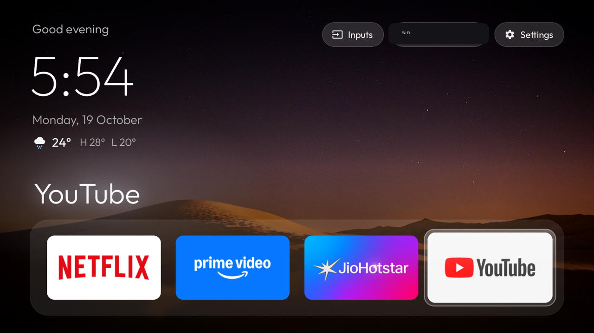
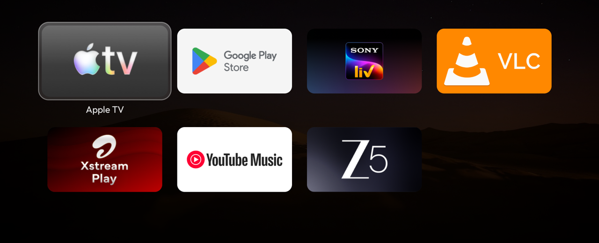

# Sony BRAVIA debloat + Apple TV–style home screen

Built and tested on a Sony BRAVIA 4K VH2 (Android TV 12, SDK 31); other Sony Android TV models
should mostly work the same way, but package names and a few Sony-specific behaviours (noted below)
may differ.




Everything here talks to the TV over Wi-Fi ADB using the Python `adb-shell` package (`./tv`),
because macOS Local Network privacy blocks the stock `adb` binary. Find your TV's IP in
**Settings → Network → Status**, then either export it once per shell (`export TV_IP=192.168.1.50`)
or prefix every command (`TV_IP=192.168.1.50 ./tv shell ...`). Turn on **Developer options → Network
debugging** on the TV first (tap the build number in About seven times to unlock Developer options).

## Setup

Setting this up yourself by hand: the steps below. Having an AI coding agent (Claude Code or
similar) do it for you instead: point it at `PROMPT.md`, which is written for that.

```sh
python3 -m venv .venv && .venv/bin/pip install -r requirements.txt
```

## Files

| File | What it does |
|---|---|
| `tv` | ADB helper: `./tv shell '<cmd>'`, `./tv key KEYCODE_X`, `./tv shot out.png`, `./tv push local remote` (base64 + md5), `./tv pull remote local`. Needs `TV_IP` set (see above). |
| `debloat-list.txt` | The 24 packages disabled (with reasons). |
| `never-disable.txt` | Packages the scripts must never disable (TV inputs, remote, keyboard, Play, Ambient Mode screensaver…). `debloat.sh` skips anything listed here. |
| `debloat.sh` | Disables everything in `debloat-list.txt`, one `pm` call per shell session. |
| `build-and-install.sh` | Builds the launcher, installs it, makes it the default home, enables the colour-button service. |
| `restore.sh` | Undoes everything (see below). |
| `launcher/` | Source of the home screen app (`com.udesh.tvhome`). |

## Undo everything

```sh
./restore.sh              # re-enable all apps + Google TV home, turn off the colour-button service
./restore.sh --uninstall  # same, and remove the custom launcher
```

## Re-enable a single app

```sh
./tv shell 'pm enable --user 0 com.amazon.music.tv'
```

Package names and why each was disabled are in `debloat-list.txt`. To disable one again:
`./tv shell 'pm disable-user --user 0 <package>'`.

Disabled (24): Sony usage data (`idd.agent`), Samba TV viewing tracker, Sony usage tracking
(`lastaccess`, `usercontext`), remote device agent (`qterics.da.product`, `da.service`),
Sony promos / Sony Select / Sony tab / app auto-installer / retail demos / Vewd app store,
Sony Music, Play Games, help guides, Sony ambient screensaver (`livingfit`, not your screensaver),
Amazon Music, Gaana, Sony Pictures Core, Google TV (Movies), iTuner Radio.

Also disabled so the custom home screen can be the default: `com.google.android.apps.tv.launcherx`
(Google TV home), `com.sony.dtv.launcherxcustomizer`, and `com.google.android.tungsten.setupwraith`
(Google's setup app, which has a higher-priority HOME screen that would otherwise always win).
If you ever factory-reset, all of this is undone automatically.

## Change the home screen

**Quick way (no rebuild):** edit `config.json` in this folder (start from `config.example.json`;
same names as `config.xml`, leave out anything you don't want to change), then run
`./config.sh push`. It copies the file to the TV and restarts the launcher. `./config.sh pull`
fetches what's on the TV, `./config.sh reset` goes back to the built-in defaults. `config.json` is
git-ignored, so your location and choices stay out of the repo.

The built-in defaults are in `launcher/app/src/main/res/values/config.xml` (edit, then
`./build-and-install.sh`).

- **Dock order**: `dock_apps`, four package names left to right
  (now Netflix, Prime Video, JioHotstar, YouTube).
- **Hide apps from the grid**: package names in `hidden_apps` (now Eco Dashboard, Timers & Clock,
  BRAVIA notifications, Media Player, TV, TV Control with Smart Speakers). Hiding only removes the
  tile; the apps keep working. Delete a line to bring a tile back.
- **Wallpaper rotation**: `wallpaper_rotate_hours` (3).
- **Arcade look** (off by default): `arcade_touches` (false). Greeting, clock, date and the big app name in the
  8-bit Press Start 2P font (SIL OFL 1.1, `assets/fonts/PressStart2P-OFL.txt`), a little chomper
  that runs along the top of the dock to the selected app eating dots, and a ghost next to the
  weather. It only animates for a moment when you move; set `false` for the plain look.
- **Apps button**: `apps_button_opens_grid` (true).
- **Colour buttons**: `key_red`, `key_green`, `key_yellow`, `key_blue`
  (now Hotstar, Apple TV, VLC, SonyLIV). Empty = the button does nothing special.
- **Where colour buttons are left alone**: `color_key_passthrough`. It contains the Sony TV
  app (Live TV and all HDMI inputs, so a set-top box on HDMI still gets the colour keys over CEC),
  the tuner, HbbTV and teletext.
- **Weather location**: `weather_lat`, `weather_lon` (defaults to 0,0 — set to your own
  coordinates, e.g. search "&lt;your city&gt; latitude longitude").
  `weather_refresh_minutes` (30) and `weather_stale_minutes` (90, after which the row is dimmed).

To find an app's package name: `./tv shell 'pm list packages | grep -i <name>'`.

### Wallpapers

Put your own landscape photos (1920x1080 JPG/PNG is ideal) on the TV in
`/sdcard/Android/data/com.udesh.tvhome/files/wallpapers/` — none are bundled in this repo. They
rotate in name order, at most every `wallpaper_rotate_hours`, changing only when you come back to
the home screen. A dark gradient keeps the clock, pills and dock readable, and the photo dims
further when you scroll to the app grid. No rebuild is needed to change them:

```sh
D=/sdcard/Android/data/com.udesh.tvhome/files/wallpapers
./tv push ~/Pictures/beach.jpg $D/wall-200.jpg     # add one
./tv shell "ls $D"                                  # list
./tv shell "rm $D/wall-046.jpg"                     # remove one
./tv shell "rm -r $D"                               # remove all = pitch black again
```

Press Home (or wait for the next rotation) to see changes. `wallpapers-CREDITS.txt` shows the
format used for crediting photo sources if you pull from a licensed set like Unsplash.

## How the launcher works

- Pitch-black background, dock of four apps in a lighter rounded band, the rest in a 4-column
  grid below. Down from the dock scrolls the grid up.
- One translucent glass highlight springs between tiles, pills and menu items. The focused tile
  grows slightly; grid tiles show their name underneath.
- The focused dock app's name is shown in large type above the dock, with a glow in a colour
  sampled from its banner.
- Top right: **Inputs** (dropdown with your HDMI ports in port order, Video/AV and Live TV,
  switched through Android's TV input framework), **Wi-Fi** (network name; opens Wi-Fi settings),
  **Settings**.
- Top left: greeting, clock, date and weather (Open-Meteo, no key). The weather is fetched only
  while the home screen is visible: on return if older than 30 minutes, and every 30 minutes while
  it stays on screen. No background service. If it has never succeeded, the row is hidden.
- D-pad: Up/Down move exactly one row; Up from the dock goes to the top bar; the ends of the top
  bar and rows stop; Back returns to the dock. The last focused tile is remembered.
- Light on memory: no blur, no video, no libraries beyond RecyclerView.

## Reordering tiles

Long-press OK/center on a dock or grid tile (the highlight turns gold) to pick it up, then use the
D-pad to swap it with its neighbour. A short OK press, or Back, drops it in place. The new order is
saved in the launcher's own prefs (survives `loadApps()` reloads and `./build-and-install.sh`
rebuilds; only wiped by clearing the launcher's app data) and merges with `dock_apps`/the grid's
alphabetical default — apps not seen before (newly installed, or before the first reorder) are
appended at the end instead of being dropped.

## Jump back to the last app

While sitting on the home screen, pressing Home again within ~0.65 s relaunches whichever app you
most recently opened from the launcher (dock or grid), instead of just re-focusing the dock. Useful
for "oops, meant to stay in what I was watching."

Permissions: `INTERNET` (weather), network/Wi-Fi state, and `ACCESS_FINE_LOCATION`, used only
because Android 12 hides the Wi-Fi network name without it. The weather uses fixed coordinates,
never your location. Revoke it with
`./tv shell 'pm revoke com.udesh.tvhome android.permission.ACCESS_FINE_LOCATION'`, and the pill
will just say "Wi-Fi".

**Live TV**: there are no tuner channels scanned on this TV, so "Live TV" opens Sony's TV app,
which resumes the last source. After a channel scan it opens the tuner channels.

## Apps button

The remote's **Apps** button opens the home screen scrolled to the app grid; pressing it again
goes back to the dock. Home on the home screen also returns to the dock.

How: Sony's system turns the Apps key into an "all apps" request addressed to the Settings app,
before any app or accessibility service sees the key. Since Google TV's home is disabled, nothing
answered it. The colour-button service watches the system log for that one request (it reads only
`ActivityTaskManager` lines, using a blocked reader with no polling, about 3 MB) and opens the grid.
This needs the `READ_LOGS` permission, which `build-and-install.sh` grants over ADB.
To turn it off: set `apps_button_opens_grid` to false and rebuild, or
`./tv shell 'pm revoke com.udesh.tvhome android.permission.READ_LOGS'`.

## Soundbar wake-up

The soundbar (Moto 160SB on HDMI 3 eARC) goes to standby on its own after a stretch of silence
while the TV stays on, and the TV doesn't wake it when playback starts. The TV's own settings were
already correct (Speakers: Audio system, Audio system prioritisation on, BRAVIA Sync on).

The colour-button service now wakes it, invisibly: when you open an app or media starts playing
while the TV's HDMI-ARC output is missing, it sends the HDMI-CEC "system audio on" request
(`cmd hdmi_control setsam on`, the same request as Speakers → Audio system). Apps aren't allowed to
send CEC on Android 12, so the launcher sends it through the TV's own ADB service (127.0.0.1:5555)
with its own key (`SoundbarWaker.java`, which can run only that one fixed command). The soundbar
reconnects about 5-8 s later. It tries at most every 30 s, and backs off for 10 minutes if the
soundbar doesn't respond (e.g. unplugged).

**This needs network debugging to stay ON.** The first time the launcher runs after install, the TV
shows an "Allow USB debugging?" prompt with the launcher's own key fingerprint — accept that one, and
say No to any other such prompt you don't expect. If debugging is off, or the authorisation is
revoked (Developer options → Revoke USB debugging authorisations), the launcher falls back to opening
Sony's Home Theatre Control panel for about half a second, which also wakes the soundbar. After a
revoke, reinstall with `./build-and-install.sh` and accept the new prompt.

Things that were tried and don't work for apps on Android 12: writing Sony's Speakers setting or
calling Sony's audio service (Sony-only permissions), Android's system-audio setting toggle and
volume nudges (ignored), and driving the quick-settings Audio output tile (it needs a real OK press,
which accessibility services can only send from Android 13).

## Colour buttons (Red/Green/Yellow/Blue)

They are handled by a small accessibility service inside the launcher ("Home colour buttons").
It filters only keycodes 183–186; every other key passes through untouched. It reads only which
app is on screen, so it can leave the buttons alone in the Sony TV app, HbbTV and teletext.

- Turn off: Settings → System → Accessibility → Home colour buttons, or
  `./tv shell 'settings delete secure enabled_accessibility_services; settings put secure accessibility_enabled 0'`.
- Turn on: `./build-and-install.sh`, or
  `./tv shell 'settings put secure enabled_accessibility_services com.udesh.tvhome/.ColorKeyService; settings put secure accessibility_enabled 1'`.

Note: `input keyevent` from ADB cannot test these buttons, because shell-injected keys skip
accessibility filtering. Use the real remote.

## Live cricket

A mini scorecard (top right of the home screen) for India men's matches and IPL: live score
with the batters at the crease and the current bowler, the next match if it starts within 18
hours, or the result for a while afterwards. Hidden when there's nothing to show. Data comes from
CricketData.org; the free key goes in `launcher/local.properties` as `cricket.apiKey=...`
(git-ignored). Free plan = 100 requests a day: it only fetches while the home screen or
screensaver is on screen, every 4 min during a live match (5 on the screensaver; that match only) and every 30 min
otherwise, and pauses for the day if the limit is hit. Settings: `cricket_enabled`,
`cricket_india_women`, `cricket_live_refresh_minutes`, `screensaver_cricket_refresh_minutes`,
`cricket_idle_refresh_minutes`.

While a match is live, a small score card also appears on the photo screensaver, just above
Ambient Mode's own clock (`screensaver_overlay`). `screensaver_clock: true` draws our own big
clock + date bottom-left instead (then turn Ambient Mode's clock off in its settings).

## Screensaver (Google Photos / Ambient Mode)

Untouched and verified working: `com.google.android.apps.tv.dreamx` (Ambient Mode) with a
Google Photos album of your choosing, starting after 10 minutes.

- Settings: while the screensaver is running, press Down → **Screensaver settings**, or
  `./tv shell 'am start -n com.google.android.apps.tv.dreamx/.settingsv2.TwoPanelActivity'`.
- Start it now: `./tv shell 'am start -n com.android.systemui/.Somnambulator'`.
- If the album ever needs picking again: in the **Google Home** app on your phone, tap the TV
  (Sony TV) → the gear (Device settings) → **Ambient mode** → **Google Photos** → select the album.

## Build environment (macOS)

JDK 17 (`brew install openjdk@17`), an Android SDK (platform 34, build-tools 34) with its path set
in `launcher/local.properties` as `sdk.dir=/path/to/android-sdk` (not committed — Android Studio or
`sdkmanager` can create one for you), Gradle 8.9 wrapper (bundled), AGP 8.5.2, `minSdk 31`.

## Keep network debugging on

The invisible soundbar wake-up (see "Soundbar wake-up") needs **Developer options → Network
debugging** to stay on. If you ever turn it off, everything else keeps working — the soundbar
wake-up just falls back to the half-second Sony panel instead.
