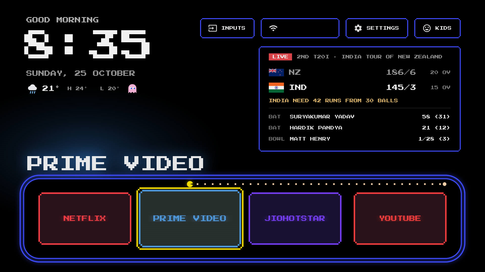

# Sony BRAVIA Launcher

A fast, clean home screen for Sony BRAVIA Android TVs, plus a debloat script. No root, no ads,
no telemetry, and everything can be undone with one command.


## Why

The stock Google TV home on a 2021 BRAVIA is sluggish and mostly promoted rows, and the TV ships
with Sony and third-party tracking and promo apps running underneath. This replaces the home with
a calm, Apple TV–style one built around the apps you actually use, and disables the rest. The whole app is
plain Java with views built in code: no frameworks, no blur, no video, nothing running when you're
not looking at it.

## What you get

- **Home screen**: greeting, clock, date and weather; a dock of four apps over a rotating photo
  wallpaper, with the full app grid below. One glass highlight glides between tiles.
- **Live cricket**: India and IPL scores on the home screen (batters, bowler, result or next match),
  and a small score card over the photo screensaver while a match is live. [More](#live-cricket)
- **Kids mode**: only the apps you allow, everything else sent back home, PIN to leave.
  [More](#kids-mode)
- **Remote shortcuts**: the Red/Green/Yellow/Blue buttons open apps of your choice, the Apps
  button opens the grid, and double-pressing Home jumps back to the last app.
  [More](#colour-buttons-redgreenyellowblue)
- **Soundbar that wakes with the TV**, fixing a common eARC/CEC annoyance. [More](#soundbar-wake-up)
- **Inputs menu** for HDMI ports and Live TV, reorderable tiles, hidden tiles.
- **Debloat**: 24 tracking, promo and unused apps disabled, with the reason for each.
  [More](#what-gets-disabled)
- **Settings without rebuilding**: edit `config.json`, run `./config.sh push`.
  [More](#change-the-home-screen)
- **Optional arcade look**: the whole home screen as an 8-bit arcade game: neon name tiles, pixel
  font, maze-style dock with a chomper eating dots, CRT scanlines (off by default).
  [Screenshot](#arcade-look)

Built and tested on a Sony BRAVIA 4K VH2 (KD-55X80J, Android TV 12 / Google TV, SDK 31). Other
Sony Android TV models should mostly work the same way, but package names and a few
Sony-specific behaviours (noted below) may differ.

## Quick start

Using an AI coding agent (Claude Code or similar)? Point it at `PROMPT.md`, which is a step-by-step
runbook written for that. By hand:

1. On the TV: **Settings → System → About**, press the build number seven times to unlock
   Developer options, then turn on **Developer options → Network debugging**. Note the TV's IP
   from **Settings → Network → Status**.
2. On your computer (building needs JDK 17 and an Android SDK, see
   [Build environment](#build-environment-macos)):

   ```sh
   python3 -m venv .venv && .venv/bin/pip install -r requirements.txt
   export TV_IP=192.168.1.50            # your TV's IP
   ./debloat.sh                         # disable the apps in debloat-list.txt
   ./build-and-install.sh               # build, install, set as home, enable the button service
   cp config.example.json config.json   # then set your weather location etc.
   ./config.sh push
   ```

3. Accept the "Allow USB debugging?" prompt on the TV (it's the launcher's own key, used only for
   the soundbar wake-up).

Everything talks to the TV over Wi-Fi ADB through `./tv`, a small Python client
(`adb-shell` package), because macOS Local Network privacy blocks the stock `adb` binary. Either
export `TV_IP` once per shell or prefix commands (`TV_IP=192.168.1.50 ./tv shell ...`).

To undo it all: `./restore.sh` (see [Undo everything](#undo-everything)).

## Files

| File | What it does |
|---|---|
| `tv` | ADB helper: `./tv shell '<cmd>'`, `./tv key KEYCODE_X`, `./tv shot out.png`, `./tv push local remote` (base64 + md5), `./tv pull remote local`. Needs `TV_IP` set. |
| `debloat-list.txt` | The 24 packages disabled (with reasons). |
| `never-disable.txt` | Packages the scripts must never disable (TV inputs, remote, keyboard, Play, Ambient Mode screensaver…). `debloat.sh` skips anything listed here. |
| `debloat.sh` | Disables everything in `debloat-list.txt`, one `pm` call per shell session. |
| `build-and-install.sh` | Builds the launcher, installs it, makes it the default home, enables the colour-button service. |
| `config.sh` | Pushes `config.json` to the TV (`push`, `pull`, `reset`). |
| `restore.sh` | Undoes everything (see below). |
| `launcher/` | Source of the home screen app (`com.udesh.tvhome`). |
| `PROMPT.md` | Setup runbook for an AI coding agent. |

## Change the home screen

**Quick way (no rebuild):** edit `config.json` in this folder (start from `config.example.json`;
same names as `config.xml`, leave out anything you don't want to change), then run
`./config.sh push`. It copies the file to the TV and restarts the launcher. `./config.sh pull`
fetches what's on the TV, `./config.sh reset` goes back to the built-in defaults. `config.json` is
git-ignored, so your location and choices stay out of the repo.

The built-in defaults are in `launcher/app/src/main/res/values/config.xml` (edit, then
`./build-and-install.sh`).

- **Dock order**: `dock_apps`, four package names left to right
  (now Netflix, Prime Video, JioHotstar, YouTube).
- **Hide apps from the grid**: package names in `hidden_apps` (now Eco Dashboard, Timers & Clock,
  BRAVIA notifications, Media Player, TV, TV Control with Smart Speakers). Hiding only removes the
  tile; the apps keep working. Delete a line to bring a tile back.
- **Wallpaper rotation**: `wallpaper_rotate_hours` (3).
- **Arcade look** (off by default): `arcade_touches` (false). See [Arcade look](#arcade-look).
- **Apps button**: `apps_button_opens_grid` (true).
- **Colour buttons**: `key_red`, `key_green`, `key_yellow`, `key_blue`
  (now Hotstar, Apple TV, VLC, SonyLIV). Empty = the button does nothing special.
- **Where colour buttons are left alone**: `color_key_passthrough`. It contains the Sony TV
  app (Live TV and all HDMI inputs, so a set-top box on HDMI still gets the colour keys over CEC),
  the tuner, HbbTV and teletext.
- **Weather location**: `weather_lat`, `weather_lon` (defaults to 0,0 — set to your own
  coordinates, e.g. search "&lt;your city&gt; latitude longitude").
  `weather_refresh_minutes` (30) and `weather_stale_minutes` (90, after which the row is dimmed).
- **Cricket and kids mode**: see [Live cricket](#live-cricket) and [Kids mode](#kids-mode).

To find an app's package name: `./tv shell 'pm list packages | grep -i <name>'`.

### Arcade look



Set `"arcade_touches": true` in `config.json` and `./config.sh push`. The whole home screen turns
into an 8-bit arcade game:

- App tiles become neon "marquee" tiles: the app's name in the Press Start 2P pixel font (SIL OFL
  1.1, `assets/fonts/PressStart2P-OFL.txt`) inside a stepped pixel frame in the app's brand
  colour, picked from its banner.
- The dock sits in a double-line blue maze corridor, with a chomper that runs along the top to the
  selected app eating dots. A yellow pixel frame marks the focused tile (green while reordering).
- Clock, date, weather, buttons, the Inputs menu and the cricket card all use the pixel font and
  blue frames; a ghost sits next to the weather.
- Black background with faint CRT scanlines (wallpapers aren't shown in this look).

It costs nothing when idle: frames and scanlines are drawn once, and the chomper only animates for
a moment when you move. (The screenshot uses a sample score.)

### Wallpapers

Put your own landscape photos (1920x1080 JPG/PNG is ideal) on the TV in
`/sdcard/Android/data/com.udesh.tvhome/files/wallpapers/` — none are bundled in this repo. They
rotate in name order, at most every `wallpaper_rotate_hours`, changing only when you come back to
the home screen. A dark gradient keeps the clock, pills and dock readable, and the photo dims
further when you scroll to the app grid. No rebuild is needed to change them:

```sh
D=/sdcard/Android/data/com.udesh.tvhome/files/wallpapers
./tv push ~/Pictures/beach.jpg $D/wall-200.jpg     # add one
./tv shell "ls $D"                                  # list
./tv shell "rm $D/wall-046.jpg"                     # remove one
./tv shell "rm -r $D"                               # remove all = pitch black again
```

Press Home (or wait for the next rotation) to see changes. `wallpapers-CREDITS.txt` shows the
format used for crediting photo sources if you pull from a licensed set like Unsplash.

## How the launcher works

- Pitch-black background, dock of four apps in a lighter rounded band, the rest in a 4-column
  grid below. Down from the dock scrolls the grid up.
- One translucent glass highlight springs between tiles, pills and menu items. The focused tile
  grows slightly; grid tiles show their name underneath.
- The focused dock app's name is shown in large type above the dock, with a glow in a colour
  sampled from its banner.
- Top right: **Inputs** (dropdown with your HDMI ports in port order, Video/AV and Live TV,
  switched through Android's TV input framework), **Wi-Fi** (network name; opens Wi-Fi settings),
  **Settings**.
- Top left: greeting, clock, date and weather (Open-Meteo, no key). The weather is fetched only
  while the home screen is visible: on return if older than 30 minutes, and every 30 minutes while
  it stays on screen. No background service. If it has never succeeded, the row is hidden.
- D-pad: Up/Down move exactly one row; Up from the dock goes to the top bar; the ends of the top
  bar and rows stop; Back returns to the dock. The last focused tile is remembered.
- Light on memory: no blur, no video, no libraries beyond RecyclerView.

**Live TV**: there are no tuner channels scanned on this TV, so "Live TV" opens Sony's TV app,
which resumes the last source. After a channel scan it opens the tuner channels.

### Reordering tiles

Long-press OK/center on a dock or grid tile (the highlight turns gold) to pick it up, then use the
D-pad to swap it with its neighbour. A short OK press, or Back, drops it in place. The new order is
saved in the launcher's own prefs (survives `loadApps()` reloads and `./build-and-install.sh`
rebuilds; only wiped by clearing the launcher's app data) and merges with `dock_apps`/the grid's
alphabetical default — apps not seen before (newly installed, or before the first reorder) are
appended at the end instead of being dropped.

### Jump back to the last app

While sitting on the home screen, pressing Home again within ~0.65 s relaunches whichever app you
most recently opened from the launcher (dock or grid), instead of just re-focusing the dock. Useful
for "oops, meant to stay in what I was watching."

## Live cricket

A mini scorecard (top right of the home screen) for India men's matches and IPL: live score
with the batters at the crease and the current bowler, the next match if it starts within 18
hours, or the result for a while afterwards. Hidden when there's nothing to show. Data comes from
ESPN's public cricket scoreboard (`site.web.api.espn.com`; no key, no daily limit). It only
fetches while the home screen or screensaver is on screen: right away when you come Home (at most
once a minute during a live match), every 4 min during a live match (5 on the screensaver) and
every 30 min otherwise, plus one check right at an upcoming match's start. To go easy on a free
feed: one request at a time, gzip (~9 KB scoreboard, ~22 KB match summary), tomorrow's fixtures
read at most every 3 h, every 15 min while play is stopped (stumps, rain, breaks), and a 429/503
from ESPN pauses fetching for at least 30 min. The feed is unofficial,
so failures are soft: the last score stays, retries back off (1, 2, 4… min), a live score that
hasn't updated for 10 min is dimmed with "Score from <time> · not updating", and it's hidden after
an hour. National teams get flat flags bundled in the app (`res/drawable-nodpi/flag_*.png`,
public-domain images from flagcdn.com); IPL teams and West Indies use ESPN's logo. Settings: `cricket_enabled`,
`cricket_india_women`, `cricket_live_refresh_minutes`, `screensaver_cricket_refresh_minutes`,
`cricket_idle_refresh_minutes`.

While a match is live, a small score card also appears on the photo screensaver, just above
Ambient Mode's own clock (`screensaver_overlay`). `screensaver_clock: true` draws our own big
clock + date bottom-left instead (then turn Ambient Mode's clock off in its settings).

## Kids mode

Set `kids_pin` (exactly 4 digits) in `config.json` and push it; a **Kids** pill appears on the home
screen. Kids mode shows only the apps in `kids_apps` (first four in the dock) and a **Parent** pill.
While it is on, the colour-button service sends anything else that comes to the front (Settings,
Play Store, other apps, HDMI inputs, Google Assistant) straight back home, ignores the Settings,
Input and Assistant buttons, and colour buttons only open kids apps. Leaving needs the PIN (number
buttons or the on-screen keypad; 5 wrong tries = 60 s wait). It stays on across TV restarts.
`kids_name` optionally shows "Hi <name>!". Inside the apps, use each app's own kids profile and
lock the adult profiles with that app's PIN (Netflix Profile Lock, Prime Video / JioHotstar
parental PIN); use YouTube Kids rather than YouTube.

## Colour buttons (Red/Green/Yellow/Blue)

They are handled by a small accessibility service inside the launcher ("Home colour buttons").
It filters only keycodes 183–186; every other key passes through untouched. It reads only which
app is on screen, so it can leave the buttons alone in the Sony TV app, HbbTV and teletext.

- Turn off: Settings → System → Accessibility → Home colour buttons, or
  `./tv shell 'settings delete secure enabled_accessibility_services; settings put secure accessibility_enabled 0'`.
- Turn on: `./build-and-install.sh`, or
  `./tv shell 'settings put secure enabled_accessibility_services com.udesh.tvhome/.ColorKeyService; settings put secure accessibility_enabled 1'`.

Note: `input keyevent` from ADB cannot test these buttons, because shell-injected keys skip
accessibility filtering. Use the real remote.

## Apps button

The remote's **Apps** button opens the home screen scrolled to the app grid; pressing it again
goes back to the dock. Home on the home screen also returns to the dock.

How: Sony's system turns the Apps key into an "all apps" request addressed to the Settings app,
before any app or accessibility service sees the key. Since Google TV's home is disabled, nothing
answered it. The colour-button service watches the system log for that one request (it reads only
`ActivityTaskManager` lines, using a blocked reader with no polling, about 3 MB) and opens the grid.
This needs the `READ_LOGS` permission, which `build-and-install.sh` grants over ADB.
To turn it off: set `apps_button_opens_grid` to false and rebuild, or
`./tv shell 'pm revoke com.udesh.tvhome android.permission.READ_LOGS'`.

## Soundbar wake-up

The soundbar (Moto 160SB on HDMI 3 eARC) goes to standby on its own after a stretch of silence
while the TV stays on, and the TV doesn't wake it when playback starts. The TV's own settings were
already correct (Speakers: Audio system, Audio system prioritisation on, BRAVIA Sync on).

The colour-button service now wakes it, invisibly: when you open an app or media starts playing
while the TV's HDMI-ARC output is missing, it sends the HDMI-CEC "system audio on" request
(`cmd hdmi_control setsam on`, the same request as Speakers → Audio system). Apps aren't allowed to
send CEC on Android 12, so the launcher sends it through the TV's own ADB service (127.0.0.1:5555)
with its own key (`SoundbarWaker.java`, which can run only that one fixed command). The soundbar
reconnects about 5-8 s later. It tries at most every 30 s, and backs off for 10 minutes if the
soundbar doesn't respond (e.g. unplugged).

**This needs Developer options → Network debugging to stay ON.** The first time the launcher runs
after install, the TV shows an "Allow USB debugging?" prompt with the launcher's own key
fingerprint — accept that one, and say No to any other such prompt you don't expect. If debugging
is off, or the authorisation is revoked (Developer options → Revoke USB debugging authorisations),
everything else keeps working and the launcher falls back to opening Sony's Home Theatre Control
panel for about half a second, which also wakes the soundbar. After a revoke, reinstall with
`./build-and-install.sh` and accept the new prompt.

Things that were tried and don't work for apps on Android 12: writing Sony's Speakers setting or
calling Sony's audio service (Sony-only permissions), Android's system-audio setting toggle and
volume nudges (ignored), and driving the quick-settings Audio output tile (it needs a real OK press,
which accessibility services can only send from Android 13).

## Screensaver (Google Photos / Ambient Mode)

Untouched and verified working: `com.google.android.apps.tv.dreamx` (Ambient Mode) with a
Google Photos album of your choosing, starting after 10 minutes.

- Settings: while the screensaver is running, press Down → **Screensaver settings**, or
  `./tv shell 'am start -n com.google.android.apps.tv.dreamx/.settingsv2.TwoPanelActivity'`.
- Start it now: `./tv shell 'am start -n com.android.systemui/.Somnambulator'`.
- If the album ever needs picking again: in the **Google Home** app on your phone, tap the TV
  (Sony TV) → the gear (Device settings) → **Ambient mode** → **Google Photos** → select the album.

## What gets disabled

Disabled (24): Sony usage data (`idd.agent`), Samba TV viewing tracker, Sony usage tracking
(`lastaccess`, `usercontext`), remote device agent (`qterics.da.product`, `da.service`),
Sony promos / Sony Select / Sony tab / app auto-installer / retail demos / Vewd app store,
Sony Music, Play Games, help guides, Sony ambient screensaver (`livingfit`, not your screensaver),
Amazon Music, Gaana, Sony Pictures Core, Google TV (Movies), iTuner Radio. Package names and the
reason for each are in `debloat-list.txt`.

Also disabled so the custom home screen can be the default: `com.google.android.apps.tv.launcherx`
(Google TV home), `com.sony.dtv.launcherxcustomizer`, and `com.google.android.tungsten.setupwraith`
(Google's setup app, which has a higher-priority HOME screen that would otherwise always win).
If you ever factory-reset, all of this is undone automatically.

Re-enable a single app, or disable one again:

```sh
./tv shell 'pm enable --user 0 com.amazon.music.tv'
./tv shell 'pm disable-user --user 0 <package>'
```

## Undo everything

```sh
./restore.sh              # re-enable all apps + Google TV home, turn off the colour-button service
./restore.sh --uninstall  # same, and remove the custom launcher
```

## Privacy and permissions

- Network is used only for the weather (Open-Meteo) and the cricket score (ESPN), and only while
  the home screen or screensaver is on screen. No analytics, no accounts, no telemetry.
- `INTERNET` and network/Wi-Fi state for the above.
- `ACCESS_FINE_LOCATION`, used only because Android 12 hides the Wi-Fi network name without it.
  The weather uses fixed coordinates from your config, never your location. Revoke it with
  `./tv shell 'pm revoke com.udesh.tvhome android.permission.ACCESS_FINE_LOCATION'`, and the pill
  will just say "Wi-Fi".
- `READ_LOGS` for the Apps button (see [Apps button](#apps-button)), granted over ADB.
- An accessibility service for the colour buttons, kids mode and the screensaver score card. It
  sees which app is in front and the colour keys (plus, only in kids mode, the Settings, Input
  and Assistant keys); every other key passes through.

## Build environment (macOS)

JDK 17 (`brew install openjdk@17`), an Android SDK (platform 34, build-tools 34) with its path set
in `launcher/local.properties` as `sdk.dir=/path/to/android-sdk` (not committed — Android Studio or
`sdkmanager` can create one for you), Gradle 8.9 wrapper (bundled), AGP 8.5.2, `minSdk 31`.

## Credits and license

MIT (see `LICENSE`). Press Start 2P font: SIL OFL 1.1. Flags: public domain via flagcdn.com.
Debloat list cross-checked with [cleanyourtv](https://github.com/Gathin23/cleanyourtv), where this
TV's list is also published.
